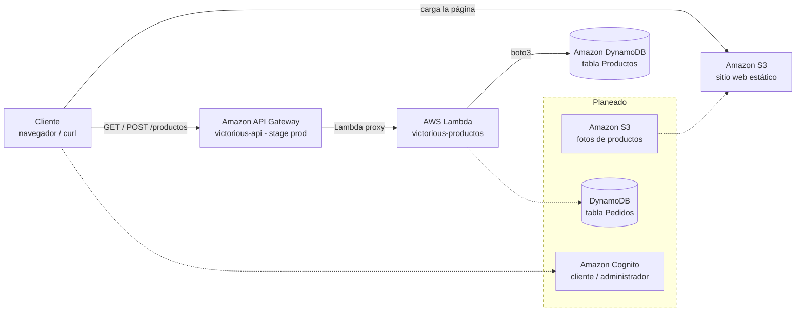

# 1. Diagrama de la solución

Caso de uso de punta a punta: **consultar el catálogo (GET) y agregar un producto (POST)**.

Línea continua: **desplegado**. Línea punteada y recuadro "Planeado": **pendiente para la final**.

| Componente | Estado |
|---|---|
| DynamoDB (tabla Productos) | Desplegado |
| Lambda `victorious-productos` (GET y POST) | Desplegado |
| API Gateway `victorious-api` (GET y POST /productos, con CORS) | Desplegado (servicio agregado respecto a la guía inicial) |
| S3: sitio web estático | Desplegado |
| S3: fotos de productos | Planeado |
| Cognito, tabla Pedidos | Planeado |
